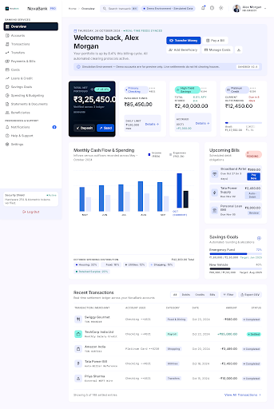
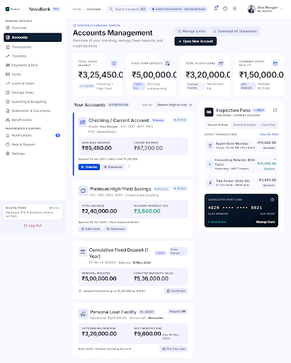
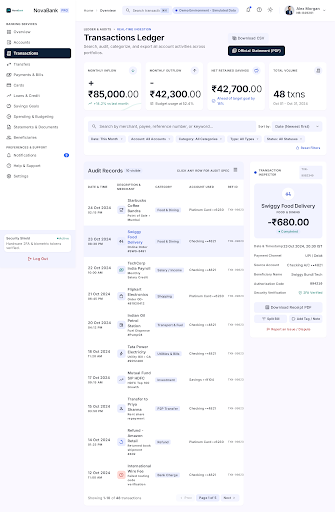
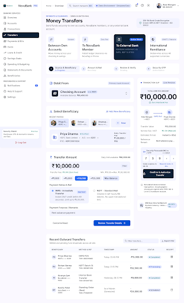
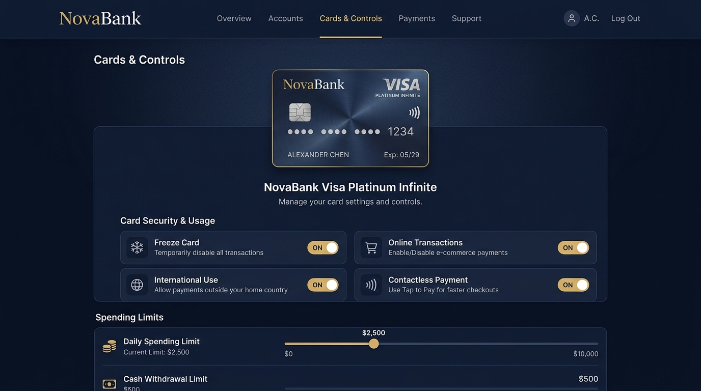
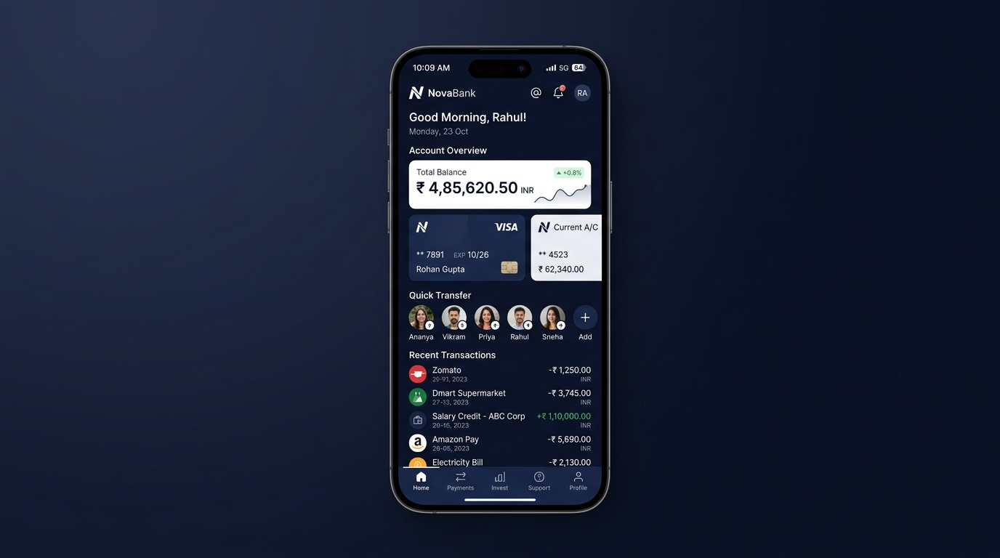

<div align="center">

# 🏦 NovaBank — Modern Digital Banking Web Application

[](https://angular.dev/)
[](https://www.typescriptlang.org/)
[](https://angular.dev/guide/signals)
[](https://stitch.googleapis.com)
[](http://localhost:4200)

**NovaBank** is a production-grade, highly responsive digital banking platform engineered as a frontend-first single page application. Powered by **Angular Standalone Components**, **Signals**, and an in-memory **JSON Mock REST Database**, NovaBank simulates full institutional banking workflows: multi-account management, instant funds transfers, live transaction auditing, card freeze controls, and smart financial budgeting.

[Technical Docs Hub](#-technical-documentation-hub) • [Architecture Guide](docs/ARCHITECTURE.md) • [Modules Guide](docs/MODULES_GUIDE.md) • [Design System](docs/DESIGN_SYSTEM.md) • [Quick Start](#-quick-start--local-setup)

---

</div>

## 📸 Visual Showcase & Screens

### 1. Main Dashboard & Portfolio Overview
The command center featuring real-time net-worth balance toggling, recent financial audits, incoming/outgoing flow indicators, and quick-action shortcuts.

<div align="center">
  
</div>

<br/>

### 2. Multi-Account Management & Inspector
Manage multiple financial instruments: Checking Accounts, High-Yield Savings, Joint Portfolios, and Term Deposits with dedicated statement downloads and branch IFSC metadata.

<div align="center">
  
</div>

<br/>

### 3. Financial Transactions & Audit Ledger
Real-time filterable transaction table with category pills, debit/credit indicators, instant CSV export, and granular transaction receipt modals.

<div align="center">
  
</div>

<br/>

### 4. Money Transfers & Beneficiary Routing
3-step secure fund transfer wizard supporting IMPS, NEFT, and Intra-bank settlements with 4-digit security OTP authentication and balance validation.

<div align="center">
  
</div>

<br/>

### 5. Card Management & Spending Controls
Glossy metallic payment cards with instant freeze/unfreeze toggles, contactless rules, online e-commerce permissions, and daily transaction cap adjustments.

<div align="center">
  
</div>

<br/>

### 6. Dedicated Mobile Banking Experience
Fully optimized mobile experience with a thumb-friendly bottom navigation bar, quick transfer avatars, and swipeable balance cards.

<div align="center">
  
</div>

---

## ⚡ Core Feature Highlights

| Module | Features & Capabilities |
| :--- | :--- |
| **Authentication & Onboarding** | Welcome sign-in portal, show/hide password toggle, remember-me session persistence, quick one-click demo login (`alex.morgan@novabank.in`). |
| **Account Overview** | Checking (`₹85,450.00`), High-Yield Savings (`₹2,40,000.00`), Joint Household (`₹1,15,000.00`), and Fixed Term Deposit (`₹5,00,000.00`). Balance visibility privacy mask. |
| **Transactions Ledger** | Real-time search by merchant/reference ID, category filtering (Food, Shopping, Utilities, Salary, etc.), date sorting, CSV export, and printable receipt modals. |
| **Money Movement** | 3-Step transfer stepper (Account $\rightarrow$ Beneficiary $\rightarrow$ Amount $\rightarrow$ OTP Review $\rightarrow$ Receipt) with balance checks and optimistic state mutation. |
| **Beneficiaries** | Directory of verified payees across HDFC, ICICI, SBI, and NovaBank with custom avatars, nickname tagging, and deletion review. |
| **Bills & Utilities** | Multi-category biller directory (Electricity, Water, Broadband, Mobile, DTH) with one-click bill payment and auto-pay indicators. |
| **Cards & Security** | Platinum Credit Card, Signature Debit Card, and Virtual SafePay Card. Real-time Freeze/Unfreeze, toggle online/international/contactless payments, and slider limit caps. |
| **Loans & Credit** | Active Personal Loan tracking, repayment schedule breakdown, and an interactive **Indicative EMI Calculator** with amount, tenure, and rate sliders. |
| **Savings Goals** | Visual financial targets (Emergency Fund, Electric SUV, Tokyo Trip) with progress meters, monthly contribution SIP reminders, and top-up funds actions. |
| **Budgeting & Spend** | Category spending utilization meters, monthly cash-flow health checks, and overspending warning flags. |
| **Documents & Statements**| Official e-statements (PDF format), Annual Interest Certificates, and TDS Form 16A download center. |
| **Customer Support**| 24x7 ticket management center, interactive message thread, dispute transaction routing, and emergency lost card assistance. |
| **Profile & Settings** | KYC profile management, light/dark theme switcher, 2FA biometric preferences, and global search modal (`Ctrl+K`). |

---

## 📚 Technical Documentation Hub

For in-depth architectural design decisions, UI tokens, and user flow documentation, explore the three dedicated guides in the [`docs/`](docs/) directory:

| Document | Primary Focus | Key Topics Covered | Link |
| :--- | :--- | :--- | :--- |
| **Architecture Deep Dive** | System design & reactive store | Standalone components, Angular Signals, optimistic UI, mock database engine, session continuity, Stitch MCP workflow | [Read Guide &rarr;](docs/ARCHITECTURE.md) |
| **Module & Feature Guide** | Functional catalog & user flows | 14 banking modules, 3-step transfer stepper, security OTP verification, card freeze toggles, EMI loan calculator, CSV exports | [Read Guide &rarr;](docs/MODULES_GUIDE.md) |
| **Design System & Tokens** | Visual language & accessibility | "Nova Precision" tokens, light/dark palettes, tabular figure typography, geometric radii, elevation scales, WCAG 2.1 AA/AAA | [Read Guide &rarr;](docs/DESIGN_SYSTEM.md) |

---

### 🏛️ 1. Architecture Deep Dive ([`docs/ARCHITECTURE.md`](docs/ARCHITECTURE.md))

The [Architecture Deep Dive](docs/ARCHITECTURE.md) documents the engineering principles, directory layout, reactive state patterns, and simulated backend engine powering NovaBank:

- **Frontend-First Single Page Architecture**: Engineered as a zero-dependency frontend application requiring no external database or server runtime. The entire backend REST layer is emulated through [`BankDataService`](src/app/core/services/bank-data.service.ts) and static JSON data.
- **Angular 19/20 Standalone Paradigm**: 100% modular standalone components with zero `NgModule` boilerplate. Each route is lazily evaluated using Angular Router's `loadComponent()`, ensuring optimal chunk splitting and sub-second initial load times.
- **Fine-Grained Reactivity with Angular Signals**:
  - Replaces heavy state management libraries (NgRx, Akita) with native Angular `signal()`, `computed()`, and `effect()`.
  - State changes (e.g. transfers, card freezing, bill payments) produce instantaneous, surgical DOM updates without full component subtree re-renders.
  - Derived signals calculate real-time net worth (`totalAvailableBalance`), primary account resolution, and unread notification tallies on the fly.
- **Optimistic State Mutation & Session Persistence**:
  - All mutating actions (fund transfers, utility settlements, profile updates) immediately mutate the in-memory signal store while simulating realistic network latency for UI skeletons.
  - State synchronizes directly with browser `sessionStorage`, ensuring testing workflows and demo mutations survive full page reloads.
- **Google Stitch MCP Engine Integration**: Direct alignment with Google's Stitch Model Context Protocol (`mcp_config.json`) to automate UI layout tokenization, responsive breakpoints, and fintech aesthetic compliance.

> 📖 **Read the full specification**: Check out [docs/ARCHITECTURE.md](docs/ARCHITECTURE.md) for signal store code snippets, mutation sequences, and complete mock schema definitions.

---

### 🧩 2. Module & Feature Guide ([`docs/MODULES_GUIDE.md`](docs/MODULES_GUIDE.md))

The [Module & Feature Guide](docs/MODULES_GUIDE.md) provides a comprehensive catalog of all 14 functional screens, business rules, and interactive user journeys implemented across the platform:

| Domain | Module Route | Interactive Capabilities & Highlights |
| :--- | :--- | :--- |
| **Authentication** | `/auth/login` | Welcome portal, show/hide password toggle, remember device session, one-click demo login (`alex.morgan@novabank.in`). |
| **Core Banking** | `/dashboard` | Total net-worth calculation, balance privacy mask (`••••••••`), cash inflow/outflow metrics, accounts carousel, quick action shortcuts, recent ledger feeds. |
| **Core Banking** | `/accounts` | Checking, High-Yield Savings, Joint, and Fixed Term deposits. Detailed account inspector drawer showing unmasked numbers, branch IFSC, interest yields, and download actions. |
| **Core Banking** | `/transactions` | Real-time text search, category filtering (Food, Shopping, Utilities, etc.), debit/credit filters, one-click CSV export, and modal digital receipts. |
| **Money Movement** | `/transfers` | 3-Step fund transfer wizard (Account Selection $\rightarrow$ Beneficiary $\rightarrow$ Amount & Note $\rightarrow$ 4-digit OTP Verification $\rightarrow$ Branded Success Receipt) with real-time balance validation. |
| **Money Movement** | `/payments` | Utility biller directory (Electricity, Water, Broadband, Mobile, DTH). One-click payment with instant optimistic status change to `PAID`. |
| **Card Services** | `/cards` | Platinum Credit, Signature Debit, and Virtual SafePay cards. Metallic gradient visuals, instant Freeze/Unfreeze toggle, contactless/international switches, and daily spending cap slider. |
| **Credit & Loans** | `/loans` | Active personal borrowings with amortization schedule breakdown, plus an interactive **Indicative EMI Calculator** with real-time principal, tenure, and rate sliders. |
| **Wealth & Savings**| `/savings` | Goal tracking (Emergency Fund, Electric SUV, Tokyo Vacation) with visual progress percentage bars, monthly SIP contribution trackers, and custom goal creation. |
| **Analytics** | `/budgeting` | Category spending budget meters, month-to-date cash flow health indicators, and real-time overspending alerts. |
| **Directory** | `/beneficiaries`| Payee phonebook with custom avatars, external bank support (HDFC, ICICI, SBI, NovaBank), and verified recipient addition/deletion. |
| **Documents** | `/statements` | Official downloadable monthly e-statements (PDF format), Annual Interest Certificates, and TDS Form 16A tax records. |
| **Help & Support** | `/support` | 24x7 customer support ticketing center, interactive conversational message thread, emergency lost/stolen card reporting, and transaction disputes. |
| **Identity & KYC** | `/settings` | Verified customer KYC profile, biometric & 2FA security preferences, notification channels, and global Light/Dark theme switcher. |

> 📖 **Read the full specification**: Check out [docs/MODULES_GUIDE.md](docs/MODULES_GUIDE.md) for detailed step-by-step user flow walkthroughs and edge-case validation behaviors.

---

### 🎨 3. Design System & Tokens ([`docs/DESIGN_SYSTEM.md`](docs/DESIGN_SYSTEM.md))

The [Design System Guide](docs/DESIGN_SYSTEM.md) documents the **Nova Precision** fintech design system, establishing a modern, trustworthy visual identity:

- **Color Semantics & Dual-Theme Tokens**:
  - **Brand Navy** (`#0D2137` / `#0F172A`): Institutional authority, logos, headers, primary shell surfaces.
  - **Royal Blue** (`#2563EB` / `#3B82F6`): Interactive buttons, focus rings, active navigation items.
  - **Mint Green** (`#10B981` / `#34D399`): Positive cash inflows, verified badges, savings achievements.
  - **Amber Gold** (`#F59E0B` / `#FBBF24`): Credit limits, pending verification states, cautionary alerts.
  - **Rose Red** (`#EF4444` / `#F87171`): Cash debits, destructive actions, emergency card freezes.
- **Financial Typography & Tabular Figures**:
  - Set in **Inter** (Google Fonts) with tight negative letter-spacing for headlines.
  - Enforces `font-variant-numeric: tabular-nums` across all currency values, interest rates, and transaction ledgers to guarantee absolute vertical column alignment.
- **Geometric Radii & Elevation Hierarchy**:
  - Micro-radii (`6px` `--radius-sm`) for badges, moderate (`10px` `--radius-md`) for controls, large (`16px` `--radius-lg`) for cards/modals, and card surfaces (`24px` `--radius-xl`).
  - Subtle multi-layered ambient shadows paired with crisp 1px borders (`#E2E8F0` / `#1E293B`) to convey physical polish without excessive blur.
- **Accessibility & Compliance (WCAG 2.1 AA/AAA)**:
  - Minimum contrast ratio of **7.5:1** across all textual elements.
  - Color-independent state indicators (every status includes both text pills and direction signs `+`/`-`).
  - High-visibility focus indicators (`3px` ring) for keyboard and screen-reader accessibility.
  - Native `prefers-reduced-motion` integration for comfortable transitions.

> 📖 **Read the full specification**: Check out [docs/DESIGN_SYSTEM.md](docs/DESIGN_SYSTEM.md) for the complete CSS variable dictionary and token mapping guide.

---

## 🏗️ Technical Architecture

NovaBank is built on a clean, scalable single-page architecture that completely decouples the frontend from backend servers while providing full reactive state and offline persistence. For the complete architecture document, see [docs/ARCHITECTURE.md](docs/ARCHITECTURE.md).

```mermaid
flowchart TD
    subgraph UI Layer
        Shell[Shell Component] --> Sidebar[Desktop Sidebar]
        Shell --> Topbar[Global Topbar + Search + Notifs]
        Shell --> BottomNav[Mobile Bottom Bar]
        Shell --> Outlet[Router Outlet / Module Views]
    end

    subgraph Reactive State Layer
        Outlet --> BDS[BankDataService (Angular Signals)]
        BDS --> UserSignal[user Signal]
        BDS --> AccountsSignal[accounts Signal]
        BDS --> TxnsSignal[transactions Signal]
        BDS --> CardsSignal[cards Signal]
        BDS --> TotalBalance[computed: totalAvailableBalance]
    end

    subgraph Mock Data & Storage
        BDS -->|Initial GET| DB[public/data/novabank-db.json]
        BDS -->|Optimistic Sync| SS[Browser sessionStorage]
    end
```

### 1. Angular Standalone Components & Signals
- **Zero NgModules**: All components (`DashboardComponent`, `AccountsComponent`, `TransfersComponent`, etc.) are standalone, reducing bundle sizes and enabling granular lazy-loading via Angular Router's `loadComponent()`.
- **Signal-Based Reactivity**: Core data structures are managed through Angular Signals (`signal()`, `computed()`), providing instantaneous UI updates when funds are transferred or cards are frozen without unnecessary CD cycles.

### 2. Central JSON Mock Database (`novabank-db.json`)
All backend entities are stored in [`public/data/novabank-db.json`](public/data/novabank-db.json). On startup, [`BankDataService`](src/app/core/services/bank-data.service.ts) queries the endpoint and synchronizes state with `sessionStorage` so your transfers and actions persist across page refreshes during prototype demonstrations.

### 3. Google Stitch MCP Engine Integration
All screen layouts and design tokens follow the **Nova Precision** design system generated and managed via the Stitch Model Context Protocol (`mcp_config.json`), ensuring consistent 8px/16px/24px roundedness, WCAG AA/AAA color contrast, and fintech aesthetics.

---

## 🎨 Design System & Branding

NovaBank implements the **Nova Precision** fintech design system. For the complete token reference and specifications, see [docs/DESIGN_SYSTEM.md](docs/DESIGN_SYSTEM.md).

- **Brand Name**: NovaBank
- **Tagline**: Banking made simpler.
- **Palette**:
  - **Primary Navy**: `#0D2137` / `#0F172A`
  - **Royal Blue**: `#2563EB`
  - **Mint / Teal Accent**: `#10B981` / `#0D9488`
  - **Surface Canvas**: `#F8FAFC` (Light) / `#080D1A` (Dark)
  - **Card Surface**: `#FFFFFF` (Light) / `#0F172A` (Dark)
- **Typography**: Inter (Google Fonts) with tabular figures for absolute column alignment in financial ledgers.
- **Elevation**: Flat base, crisp 1px borders (`#E2E8F0`), and soft ambient shadows (`0 4px 6px -1px rgba(...)`).

---

## 📁 Project Directory Structure

```text
├── docs/                                  # Showcase documentation & assets
│   ├── images/                            # High-resolution screenshots
│   ├── ARCHITECTURE.md                    # Technical architecture deep dive
│   ├── MODULES_GUIDE.md                   # Complete module & feature guide
│   └── DESIGN_SYSTEM.md                   # Tokens, palettes & typography
├── public/
│   └── data/
│       └── novabank-db.json               # Central mock banking database
├── src/
│   ├── app/
│   │   ├── core/
│   │   │   ├── models/                    # bank.models.ts (TypeScript interfaces)
│   │   │   └── services/                  # bank-data.service.ts, theme.service.ts, auth.service.ts
│   │   ├── layout/
│   │   │   ├── sidebar/                   # Persistent left navigation
│   │   │   ├── topbar/                    # Global header with search & alerts
│   │   │   ├── bottom-nav/                # Mobile navigation bar
│   │   │   └── shell/                     # Layout coordinator & drawer
│   │   ├── modules/
│   │   │   ├── auth/                      # Login & authentication view
│   │   │   ├── dashboard/                 # Primary overview & metrics
│   │   │   ├── accounts/                  # Multi-account grid & detail
│   │   │   ├── transactions/              # Audit ledger, filters & CSV
│   │   │   ├── transfers/                 # 3-Step fund transfer wizard
│   │   │   ├── payments/                  # Utility bills & recharges
│   │   │   ├── cards/                     # Card controls & freeze actions
│   │   │   ├── loans/                     # Active loans & EMI calculator
│   │   │   ├── savings/                   # Goals progress & deposits
│   │   │   ├── budgeting/                 # Spend utilization & analytics
│   │   │   ├── beneficiaries/             # Payee directory management
│   │   │   ├── statements/                # Official PDF statement downloads
│   │   │   ├── support/                   # Help center & ticketing
│   │   │   └── settings/                  # User profile & preferences
│   │   ├── app.config.ts                  # HttpClient & view transitions
│   │   └── app.routes.ts                  # Lazy-loaded route table
│   ├── index.html                         # Typography & SEO metadata
│   └── styles.css                         # Design system tokens & utility classes
├── mcp_config.json                        # Stitch MCP Server Configuration
└── package.json                           # Dependencies & run scripts
```

---

## 🚀 Quick Start & Local Setup

### Prerequisites
- **Node.js**: v18.x or later (v24.x recommended)
- **npm**: v9.x or later

### Installation & Run

1. **Clone the repository**:
   ```bash
   git clone https://github.com/your-username/novabank.git
   cd novabank
   ```

2. **Install dependencies**:
   ```bash
   npm install
   ```

3. **Start the local development server**:
   ```bash
   npm start
   ```

4. **Open in browser**:
   Navigate to [http://localhost:4200](http://localhost:4200) to view the live application.

5. **Demo Credentials**:
   - **User**: Alex Morgan
   - **Email**: `alex.morgan@novabank.in`
   - **Password**: Any password or click **⚡ Quick Demo Auto-Fill** on the login page.

---

## 📄 License & Attribution

This project is created for portfolio showcase and educational purposes. Designed and architected using Google Antigravity & the Stitch Model Context Protocol. Fictional bank data is modeled for realistic demonstration only.
